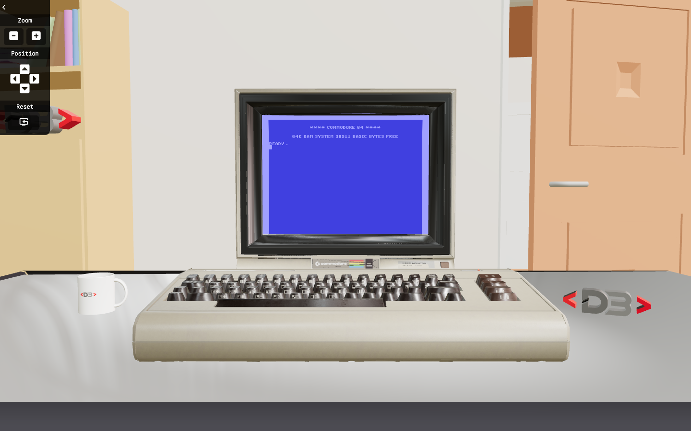

# React Three Fiber C64

A 3D scene built with React Three Fiber and drei that shows a Commodore 64 on a desk, with a live website rendered on its screen through an HTML frame embedded in the 3D scene.

**Live demo:** <https://c64.davidebalice.dev/>



## Features

- 3D Commodore 64 model with a website displayed on its screen (drei `<Html>` + iframe, with occlusion)
- Desk scene with table, chair, mug and logo models (glTF)
- Zoom controls with smooth, animated camera transitions between three positions
- Drag to rotate the scene (`PresentationControls`)
- Environment lighting, spotlight and contact shadows
- Preloader driven by the asset loading progress
- Info modal

## Tech stack

- [React 18](https://react.dev/) with TypeScript
- [Three.js](https://threejs.org/)
- [React Three Fiber](https://r3f.docs.pmnd.rs/)
- [drei](https://drei.docs.pmnd.rs/)
- [Vite](https://vite.dev/)

## Getting started

### Requirements

- Node.js 18 or later
- npm

### Installation

```bash
git clone https://github.com/davidebalice/react-fiber-c64.git
cd react-fiber-c64
npm install
```

### 3D models and textures

The 3D models (`.gltf`) and textures are loaded from `public/assets/model/`, which is excluded from the repository (see `.gitignore`).
Add your own files there before running the project:

```
public/assets/model/
├── c64.gltf
├── dblogo.gltf
├── mug.gltf
├── old-chair.gltf
├── old-table.gltf
└── textures/      # logoWhite.png, logoReact.png, plus.png, minus.png, info.png, github_white.png
```

The website shown on the C64 screen is set by `websiteUrl` in `src/App.tsx`.

### Available scripts

| Command           | Description                                  |
| ----------------- | -------------------------------------------- |
| `npm run dev`     | Start the development server                 |
| `npm run build`   | Type-check and create a production build in `dist/` |
| `npm run preview` | Preview the production build locally         |

## Project structure

```
src/
├── App.tsx        # Entry point: canvas, camera state, UI
├── Scene.tsx      # Lights, controls, camera controller and models
├── C64.tsx        # C64 model with the HTML frame
├── Chair.tsx, Table.tsx, Mug.tsx, DbLogo.tsx
├── Header.tsx     # Zoom controls
├── Footer.tsx     # Links and info button
├── Modal.tsx      # Info modal
└── Preloader.tsx
```

## Author

**Davide Balice** – [davidebalice.dev](https://www.davidebalice.dev)
